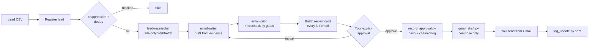

# Outreach Studio Agent

**A human-in-the-loop cold-email agent for [Claude Code](https://claude.com/claude-code) that can't send email.**

It researches each lead from the lead's own website, drafts honest personalized
cold email, runs deterministic quality and compliance gates, and, only after
you approve the exact text in your own words, creates a **Gmail draft**. You
read it and click send yourself.

The safety rules aren't just prompts. They're enforced in code: hooks block
network and mail commands, approvals are hash-anchored to the exact email and
logged in a tamper-evident chain, and only text *you typed* can count as
approval. A prompt injection on a lead's website or in a prospect's reply
can't approve, change or send anything.

[](LICENSE)


---

## Contents
- [Why](#why)
- [How it works](#how-it-works)
- [Features](#features)
- [Requirements](#requirements)
- [Installation](#installation)
- [Configuration](#configuration)
- [Usage](#usage)
- [How approval works](#how-approval-works)
- [Project layout](#project-layout)
- [Testing](#testing)
- [Customizing for your own offer](#customizing-for-your-own-offer)
- [Compliance](#compliance)
- [Contributing](#contributing)
- [License](#license)

## Why

LLM agents are good at research and writing, and risky when they have an
outbound channel. This project shows a pattern for keeping a human firmly in
control:

1. **No send capability exists.** The only outbound action is "create a
   draft", and only after a recorded approval.
2. **Approval is cryptographically tied to content.** Change one character of
   the subject, body, recipient or CTA, and the approval is void.
3. **Untrusted input stays data.** Website text and prospect replies are
   analyzed, never obeyed.
4. **Gates are scripts, not vibes.** Suppression, dedup, placeholders, demo
   numbers and banned phrases are hard blocks with exit codes the model
   can't talk its way past.

It ships configured for two example campaigns (med spas and auto dealers),
each with its own offer, demo and proof rules. You can swap in your own.

## How it works



Each step changes state through `scripts/log_update.py`, which only allows
valid transitions and rebuilds an HTML pipeline dashboard in `outputs/`.

Enforcement is layered. Details are in [docs/ARCHITECTURE.md](docs/ARCHITECTURE.md).

| layer | mechanism | bypassable by the model? |
|---|---|---|
| Capability | No send credentials. The only outbound call is a *create-draft* webhook. | No |
| Permissions | `.claude/settings.json` allowlist; curl/wget/smtp denied | Only by prompting you |
| Hooks | Pre-tool-use guards on Bash, Write/Edit and WebFetch; fail closed | No |
| Gate scripts | Deterministic exit codes (`precheck.py`) | No |
| Trust anchors | Operator prompt log + hash-chained approvals log | No (write-protected) |
| Prompts | `CLAUDE.md`, skills, agents | Guidance only; layers above catch mistakes |

## Features

- **Batch workflow:** next 10 leads from a CSV, researched in parallel, one
  review card showing every complete email.
- **Site-only research:** WebFetch is limited to the lead's own domain (plus an
  allowlist). Every personalization line cites its source.
- **Honest copy:** no invented metrics, clients or testimonials. Unknown facts
  become `[[MISSING: …]]` and block the draft until resolved.
- **Per-vertical proof:** each campaign has its own positioning file and demo
  number. Citing one campaign's demo to the other's lead is a hard block.
- **Follow-ups and replies:** F1 to F3 sequences, a reply analyst that
  classifies intent, and automatic suppression on opt-out.
- **Pipeline dashboard:** status, follow-ups due, and reply rate per
  `message_version`.
- **Test suites:** 48 deterministic unit tests (stdlib only, no model calls)
  plus 9 behavioral evals for `claude plugin eval`, including prompt-injection
  and vague-approval cases.

## Requirements

| | |
|---|---|
| [Claude Code](https://docs.claude.com/en/docs/claude-code) | CLI, desktop or IDE extension |
| Python | 3.9+ (stdlib only) |
| Git Bash | Windows only: Claude Code runs hooks through it |
| n8n (optional) | A webhook with a Gmail **Create Draft** node to push drafts into Gmail |

## Installation

```bash
git clone https://github.com/<your-username>/outreach-studio-agent.git
cd outreach-studio-agent
python3 -m unittest discover -s tests      # 48 tests, ~20 s
claude
```

Open Claude Code at the **repository root** so it finds `.claude/` (agents,
skills, hooks, settings). Windows users: see
[QUICKSTART-WINDOWS.md](QUICKSTART-WINDOWS.md).

The first session runs a briefing hook that lists any setup items still
missing.

## Configuration

| what | where | notes |
|---|---|---|
| Sender identity + CAN-SPAM footer | `references/sender-profile.md` | Set `postal_address`, then `require_footer: true` |
| Med-spa offer + demo number | `references/positioning-medspa.md` | `CANONICAL-DEMO-NUMBERS` block (ships with a `555` placeholder) |
| Dealer offer + demo number | `references/positioning-dealers.md` | Dealer drafts must be number-free until set |
| Extra research domains | `references/allowed-research-domains.txt` | One host per line |
| Gmail draft webhook | `OUTREACH_COMPOSE_WEBHOOK` env var | Unset: approved drafts are saved to `data/drafts/approved/` |

```bash
# macOS / Linux
export OUTREACH_COMPOSE_WEBHOOK="https://your-n8n-host/webhook/compose-draft"
```
```powershell
# Windows PowerShell
$env:OUTREACH_COMPOSE_WEBHOOK = "https://your-n8n-host/webhook/compose-draft"
```

> **The webhook's workflow must have a Gmail *Create Draft* node and no send
> node.** That's the line between "draft" and "send".

### Lead CSV format

```csv
Name,Website,Email,Region,vertical
Aurora Med Spa,https://auroramedspa.example/,frontdesk@auroramedspa.example,Boise,medspa
Lone Star Motors,https://lonestarmotors.example/,sales@lonestarmotors.example,Austin,dealers
```
See [inputs/example-leads.csv](inputs/example-leads.csv). Real lead CSVs in
`inputs/` are git-ignored.

## Usage

Inside Claude Code:

| command | what it does |
|---|---|
| `/outreach new <csv> --vertical <medspa\|dealers>` | Next batch of 10: research, draft, review, one batch card |
| `/outreach new <domain>` | One lead end to end |
| `/draft-email <lead>` | Single draft or revision loop |
| `/followup <lead>` | Next follow-up (F1 to F3) |
| `/reply <lead>` | Paste a prospect's reply: classify, log, suppress opt-outs, draft a response |
| `/outreach sent <ids>` | Log what you sent by hand (feeds dedup and follow-ups) |
| `/outreach-status` | Pipeline, follow-ups due, reply metrics per angle |
| `/outreach-selftest` | Test suite + approval-chain check + draft audit |

Example session:

```text
/outreach new inputs/example-leads.csv --vertical medspa
   … review card with every full email …
Approve the batch except #2
   … Gmail drafts created; send them yourself …
/outreach sent aurora-medspa
```

## How approval works

1. Claude shows the complete email and waits.
2. You type an explicit approval, for example *"Approve this exact draft"* or
   *"Approve the batch except #3"*. "Looks good", "continue" or silence
   **don't count**.
3. A `UserPromptSubmit` hook has already logged your words to
   `data/.operator/prompts.jsonl`. `record_approval.py` accepts only approval
   text found there, so a web page, a prospect's reply, or Claude itself
   can't approve. Pasted blocks are tagged and never count.
4. The script hashes the exact email, writes the approval into the draft, and
   appends a hash-chained line to `data/approvals.log`.
5. `gmail_draft.py` re-checks the hash, the chain, the 7-day expiry and every
   gate before creating the draft. Any edit after approval voids it.

The full policy is in [references/approval-policy.md](references/approval-policy.md).

## Project layout

```
.claude/
  agents/        lead-researcher, email-writer, email-critic, reply-analyst
  skills/        outreach, draft-email, followup, reply, research-lead,
                 outreach-status, outreach-selftest, cold-email-craft (vendored, MIT)
  hooks/         session_start, capture_operator_input, guard_bash,
                 guard_files, guard_webfetch, post_draft_lint, run.sh
  settings.json  permissions + hook wiring
.claude-plugin/  plugin manifest (used by `claude plugin eval`)
scripts/         gates, approval, Gmail draft, state machine, dashboard
references/      positioning, guardrails, approval policy, email craft, sender profile
templates/       JSON schemas for drafts and research, empty data shapes
tests/           deterministic unit tests (unittest, stdlib only)
evals/           behavioral eval cases + fixtures
examples/        one fully worked lead (research → draft → critic → approval)
docs/            ARCHITECTURE, EVALS, SKILLS
data/ state/ outputs/ inputs/   your live pipeline (git-ignored)
```

## Testing

```bash
python3 -m unittest discover -s tests          # deterministic, free
claude plugin eval evals                       # behavioral, uses model calls
```

See [docs/EVALS.md](docs/EVALS.md) for what each eval checks, cost and CI
setup.

## Customizing for your own offer

1. Edit or replace `references/positioning-*.md` with your offer, proof
   rules and demo number. `references/positioning.md` routes verticals to files.
2. Put your identity and postal address in `references/sender-profile.md`.
3. Adjust banned phrases in `references/guardrails.md`.
4. Run the tests.

`.claude/`, `scripts/` and `references/guardrails.md` are **read-only to the
agent** so it can't weaken its own gates. To have Claude edit them, launch it
in maintenance mode:

```bash
OUTREACH_MAINTENANCE=1 claude                      # macOS / Linux
$env:OUTREACH_MAINTENANCE=1; claude                # PowerShell
```

## Compliance

You're responsible for following the email laws where your recipients are
(for example CAN-SPAM in the US, CASL in Canada, the Spam Act in Australia,
and GDPR/PECR in the UK/EU). The agent supports this with a postal-address
footer, an opt-out line, a suppression list and reply-based opt-out
handling, but none of it is legal advice. Recommended sending posture is in
`CLAUDE.md`: a warmed domain, 15 to 20 sends per day per inbox, plain text,
and no links in the first touch.

## Contributing

Issues and PRs are welcome. See [CONTRIBUTING.md](CONTRIBUTING.md). Changes
that add any send, schedule or forward path won't be accepted.

## License

[MIT](LICENSE). The vendored `cold-email-craft` upstream material is MIT
licensed by its original author. See
[.claude/skills/cold-email-craft/upstream/LICENSE](.claude/skills/cold-email-craft/upstream/LICENSE).
